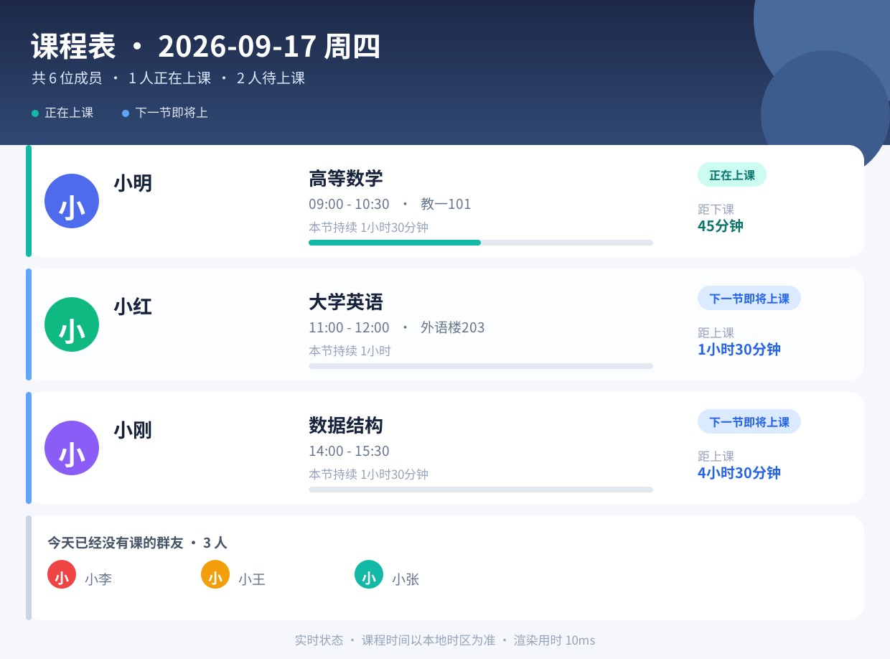
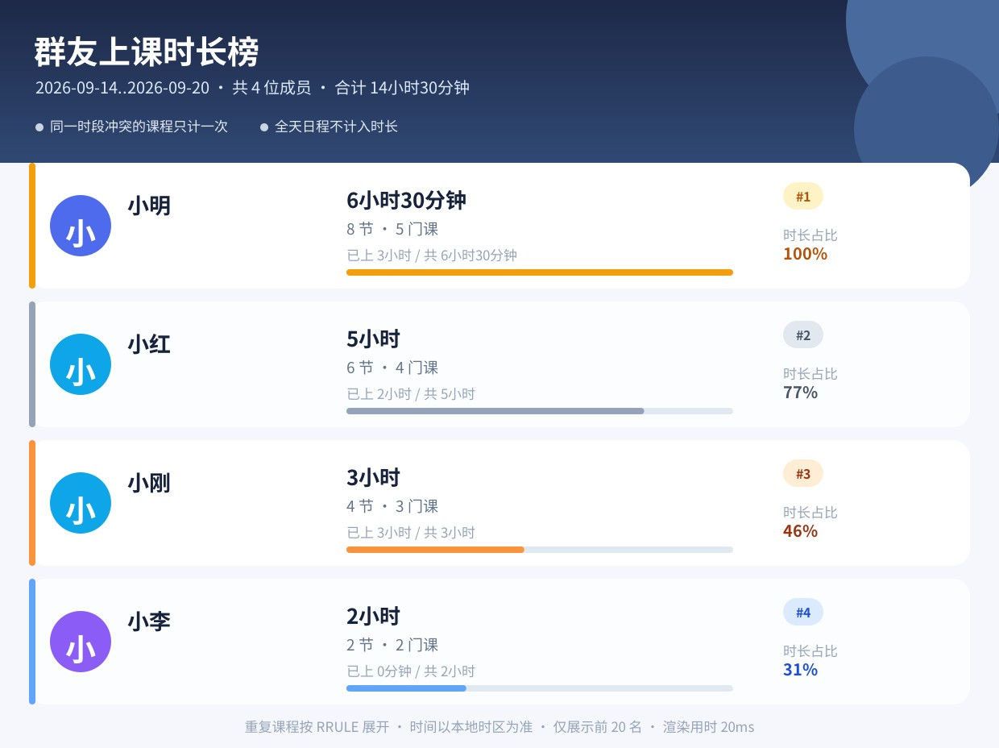

# qqbot-course-schedule

基于 QQ 官方机器人 API v2 + Go 的群聊课表机器人。

项目只支持 QQ 群聊。成员身份始终是 `(group_openid, member_openid)`；
`member_openid` 是平台签发的群内标识，不是昵称或 QQ 号。

## 文档

| 文档 | 内容 |
| --- | --- |
| [CONTRIBUTING.md](CONTRIBUTING.md) | 强制变更流程、文档映射、验证和推送规则 |
| [ARCHITECTURE.md](ARCHITECTURE.md) | 当前架构、身份、端口、SQLite v7、测试和 CI |
| [PLAN.md](PLAN.md) | 当前功能规格、边界和决策 |
| [DEV-GUIDE.md](DEV-GUIDE.md) | 本地开发、调试、测试和部署流程 |
| [CONNECT.md](CONNECT.md) | QQ 平台接入与验收 |
| [REFACTOR-GUIDE.md](REFACTOR-GUIDE.md) | 已结束重构的历史归档 |
| [COVERAGE-AstrBot.md](COVERAGE-AstrBot.md) | AstrBot 适配度研究 |

`docs/` 只保存 QQ 官方文档快照。

## 能力

| 类别 | 功能 |
| --- | --- |
| 课表 | `/课表 [日期/时间]`，纯 Go 图片卡片 |
| ICS | 群内 `.ics` 自动导入，管理台批量/单人导入导出 |
| WakeUp | `/wakeup`、分享链接/口令/文案导入 |
| 榜单 | `/上课时长榜` 及别名，群内隔离 |
| 标记 | `/休假`、`/调休`、`/销假`、`/假期` |
| 编辑 | WebUI、revision CAS、成员课表删除确认、公开 token 编辑页 |
| 成员 | 群内昵称、可选 QQ 头像绑定、seen/roster |
| 设置 | 总开关、隔离/全局模式、回复策略、图片/Markdown、昵称、管理员 |
| 平台 | Webhook、互动 ACK、群指令面板、卡片按钮 |

单聊、主动推送和 AI 工具不在当前范围。课表支持隔离模式与显式全局模式；
全局模式会优先按 `union_openid`、缺少 union 时按 `member_openid` 查找成员已有课表。

## 快速开始

```bash
cp config.example.json config.json
$EDITOR config.json
go run ./cmd/bot
```

默认监听 `127.0.0.1:18080`，Webhook 路径 `/webhook`。

```bash
curl -s http://127.0.0.1:18080/healthz
```

平台接入见 [CONNECT.md](CONNECT.md)。

## 开发检查

```bash
bash scripts/check-architecture.sh
gofmt -l .
go vet ./cmd/... ./internal/... ./tests/... ./web
go test ./internal/... ./tests/...
```

完整门禁：

```bash
COVERAGE_STAGE=p2 bash scripts/test-all.sh
RUN_WEB=1 COVERAGE_STAGE=p2 bash scripts/test-all.sh
```

当前 Go 总覆盖率 75.1%，CI 强制 75% 下限。后续覆盖率阶梯记录在
[ARCHITECTURE.md](ARCHITECTURE.md#83-必须通过的检查)。

## 部署

```bash
./deploy/deploy.sh
./deploy/deploy.sh --web
```

部署目标默认是 `as:/opt/qqbot-course-schedule`，详见 [deploy/README.md](deploy/README.md)。





## 许可证

待定。功能设计源自作者自有项目；部分框架思路参考 MIT 项目。
